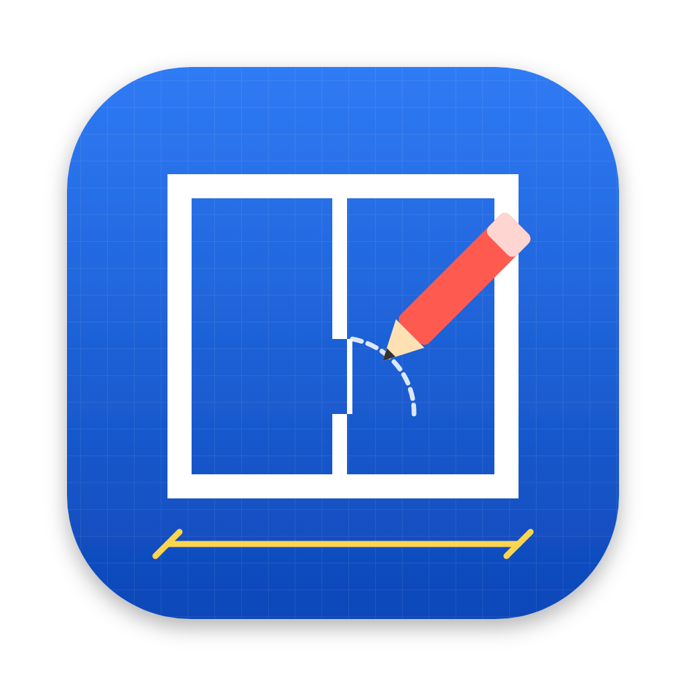

# Grundriss

PDF-Viewer und -Editor für Architekturzeichnungen auf dem Mac: Pläne ansehen, annotieren,
maßstäblich messen, Grundriss-Elemente mit Parametern einzeichnen und Bereiche löschen.



## Funktionen

**Ansehen**
- Mehrseitige PDFs mit Seitenminiaturen, gedrehte Seiten, kennwortgeschützte PDFs
- Flüssiges Zoomen (Zwei-Finger-Geste, ⌘ + Scrollen) bis 6400 %, in jeder Stufe scharf
- Verschieben mit zwei Fingern, Leertaste + Ziehen oder dem Hand-Werkzeug

**Markieren**
- Stift, Textmarker, Text (mit Rahmen und Hintergrund), Linie, Pfeil, Polylinie,
  Rechteck, Ellipse, Revisionswolke
- Linienfarbe, Füllung mit Deckkraft, Linienstärke in mm (0,13 / 0,18 / 0,25 / 0,35 / 0,5 …),
  Linienart (gestrichelt, gepunktet, Strich-Punkt)

**Messen**
- Maßstab je Seite: Normmaßstäbe (1:1 bis 1:5000), automatische Erkennung aus der
  Planbeschriftung („M 1:100“) oder **Kalibrieren** an einer bekannten Strecke
- Distanz (als Bemaßung mit Architektenstrich, Pfeil oder Punkt), Kettenmaß, Fläche mit Umfang
- **Objektfang** auf Endpunkte, Mittelpunkte und Schnittpunkte der Linien im PDF-Plan
  und der eigenen Elemente (⌘ gedrückt halten = Fang aus)
- ⇧ für 45°-Schritte, Länge per Tastatur eingeben (z. B. `3,65` oder `120cm`, dann ↩)
- Einheit m, cm oder mm

**Grundriss-Elemente (mit realen Maßen als Parameter)**
- **Wand**: Wandstärke (11,5 / 17,5 / 24 / 36,5 cm …), Bezugslinie (Achse, links, rechts),
  voll, schraffiert oder leer, offen oder geschlossen
- **Tür**: Dreh- (1- und 2-flügelig) oder Schiebetür, lichte Breite, Höhe, Wanddicke,
  Anschlag und Aufschlagrichtung, Beschriftung (z. B. „88,5/201“)
- **Fenster**: Breite, Höhe, Brüstungshöhe, Flügelzahl, Beschriftung
- Türen und Fenster rasten auf gezeichnete Wände ein (Ausrichtung und Wanddicke werden
  übernommen). Auf Wänden des PDF-Plans: von Laibung zu Laibung ziehen.
- **Treppe**: Laufbreite, Lauflänge, Steigungen, Geschosshöhe → Steigungsverhältnis
  und Schrittmaßregel werden berechnet
- **Raum**: Raumname, Fläche (m²), Umfang, lichte Höhe – Fläche wird automatisch berechnet
- **Stütze** (eckig/rund), **Einrichtung**: Bett, Sofa, Tisch mit Stühlen, Schrank,
  Küchenzeile, WC, Waschtisch, Dusche, Badewanne, Waschmaschine, Pkw-Stellplatz
- Alle Elemente lassen sich verschieben, drehen (Drehgriff, R-Taste), spiegeln und in
  der Größe ändern; Parameter im Eigenschaften-Panel rechts

**Bereich löschen**
- Rechteck aufziehen: eigene Elemente darin löschen (berührt oder vollständig enthalten)
  und/oder den Planinhalt des PDFs weiß abdecken („radieren“)

**Sichern**
- ⌘S sichert eine PDF, in der alle Elemente als echte Vektorgrafik enthalten sind –
  sichtbar in Vorschau, Acrobat und jedem anderen PDF-Programm
- Grundriss bettet zusätzlich die Bearbeitungsdaten ein: Beim erneuten Öffnen sind alle
  Elemente wieder bearbeitbar, der Originalplan bleibt unverändert
- „Als PDF exportieren (nicht mehr bearbeitbar)“ (⌥⌘E) erzeugt eine flache PDF ohne
  Bearbeitungsdaten
- Geschützte PDFs (Bearbeitungsschutz/Verschlüsselung) werden beim Sichern als
  hochaufgelöstes Bild (200 dpi) übernommen, die Elemente bleiben Vektoren

## Installation auf dem Mac

### Variante A: fertige App von GitHub

1. Auf GitHub unter **Actions → „Mac-App bauen“ → Run workflow** den Build starten
   (der Button erscheint, sobald der Workflow im Haupt-Branch liegt) – oder ein Tag
   `v1.0.0` pushen.
2. Nach ein paar Minuten unter dem Lauf das Artefakt **Grundriss-macOS** herunterladen,
   entpacken und die `.dmg` für deinen Mac öffnen (`arm64` = Apple Silicon M1–M4,
   `x64` = Intel).
3. Grundriss in den Programme-Ordner ziehen.

### Variante B: selbst bauen

Voraussetzung: [Node.js 22](https://nodejs.org) (z. B. `brew install node@22`).

```bash
git clone https://github.com/dgossow/grundriss.git
cd grundriss
npm install
npm run dist:mac        # erzeugt dist/Grundriss-1.0.0-arm64.dmg und …-x64.dmg
```

Oder ohne Installation direkt starten:

```bash
npm start
```

### Erster Start

Die App ist nicht von Apple notarisiert. Beim ersten Öffnen deshalb im Finder
**Rechtsklick auf Grundriss → Öffnen → Öffnen** wählen. Falls macOS meldet, die App sei
„beschädigt“, einmal im Terminal ausführen:

```bash
xattr -dr com.apple.quarantine /Applications/Grundriss.app
```

PDFs lassen sich per Doppelklick („Öffnen mit → Grundriss“), über ⌘O oder per
Drag & Drop auf das Fenster bzw. das Dock-Symbol öffnen.

## Kurzanleitung

1. **PDF öffnen** (⌘O).
2. **Maßstab prüfen** (rechts unter „Seite“ oder unten in der Statusleiste). Steht
   „M 1:100“ im Plan, wird das erkannt. Sicherer ist **Kalibrieren** (K): eine bekannte
   Strecke abgreifen (z. B. eine Bemaßung im Plan) und die reale Länge eingeben.
3. **Messen** (M): zwei Punkte klicken – der Fang rastet auf die Linien des Plans ein.
4. **Zeichnen**: Werkzeug links wählen, Voreinstellungen (Wandstärke, Türbreite …)
   rechts anpassen, dann im Plan klicken.
5. **Bearbeiten**: mit der Auswahl (V) anklicken, Griffe ziehen, Werte rechts ändern.
6. **Sichern** (⌘S).

## Tastaturkürzel

| Taste | Werkzeug | | Taste | Werkzeug |
|---|---|---|---|---|
| V | Auswahl | | K | Maßstab kalibrieren |
| H / Leertaste | Hand | | M | Distanz messen |
| P | Stift | | J | Kettenmaß |
| I | Textmarker | | F | Fläche messen |
| T | Text | | W | Wand |
| L | Linie | | D | Tür |
| A | Pfeil | | N | Fenster |
| Y | Polylinie | | S | Treppe |
| R | Rechteck | | B | Raum |
| O | Ellipse | | U | Stütze |
| C | Revisionswolke | | G | Einrichtung |
| E | Bereich löschen | | | |

| Kürzel | Funktion |
|---|---|
| ⇧ beim Zeichnen | 45°-Schritte, Quadrat, Kreis |
| Zahl + ↩ beim Zeichnen | Länge eingeben (Linie, Wand, Polylinie) |
| ↩ / Doppelklick | Polylinie, Wand, Fläche, Raum abschließen |
| ⌫ | Auswahl löschen / letzten Punkt entfernen |
| Esc | Abbrechen, Auswahl aufheben, zurück zur Auswahl |
| R / X / F (beim Platzieren) | drehen / spiegeln (Anschlag) / Aufschlag wechseln |
| Doppelklick auf Linie | Punkt einfügen (⌥-Klick auf Punkt = löschen) |
| ⌥ + Ziehen | Kopie verschieben |
| Pfeiltasten | Auswahl verschieben (⇧ = ×10) |
| ⌘Z / ⇧⌘Z | Widerrufen / Wiederholen |
| ⌘C / ⌘V / ⌘D | Kopieren / Einsetzen / Duplizieren |
| ⌘0 / ⌘9 / ⌘1 | Ganze Seite / Seitenbreite / 100 % |
| ⌘/ | alle Tastaturkürzel anzeigen |

## Hinweise

- **Maßstab**: Messen ist nur so genau wie die PDF. Wurde ein Plan beim Erstellen
  skaliert (z. B. A1-Plan auf A3 gedruckt), stimmt der aufgedruckte Maßstab nicht mehr –
  dann kalibrieren.
- **Bereich löschen / Abdecken**: Der Planinhalt wird weiß überdeckt, aber nicht aus der
  Datei entfernt. Für das Schwärzen vertraulicher Inhalte ist die Funktion nicht gedacht.
- Texte verwenden Helvetica; Zeichen außerhalb des westeuropäischen Zeichensatzes
  werden als „?“ ausgegeben.

## Entwicklung

```bash
npm install
npm run dev            # Oberfläche im Browser (http://localhost:5173)
npm start              # als Electron-App
npm test               # Typprüfung, Build und End-to-End-Test im Browser
npm run test:electron  # Rauchtest der Electron-App (unter Linux: xvfb-run -a …)
```

Aufbau:

- `electron/` – Hauptprozess (Fenster, Menü, Dateizugriff) und Preload-Brücke
- `src/elements/` – alle Elementtypen: Geometrie, Parameter, Griffe
- `src/render/` – Zeichenprimitive, SVG-Ausgabe, Trefferprüfung
- `src/editor/` – Ansicht/Kamera, Werkzeuge, Fang, Rückgängig
- `src/pdf/` – pdf.js-Anbindung, Vektorauslese für den Fang, Sichern mit pdf-lib
- `src/ui/` – Eigenschaften-Panel, Dialoge, Icons

Jedes Element wird in Zeichenprimitive (Pfade, Texte) zerlegt; daraus entstehen sowohl die
Bildschirmdarstellung (SVG) als auch der PDF-Export, sodass beide identisch aussehen.
